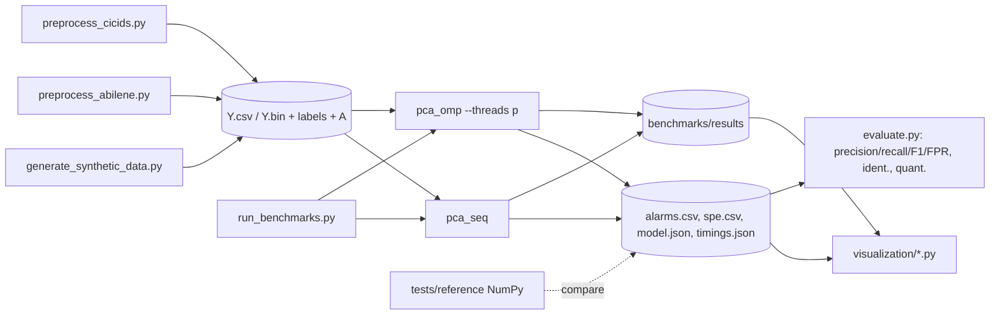

# Phase 1 — Paper Analysis and Technical Design

**Project:** Parallel PCA-Based Network-Wide Traffic Anomaly Detection Using OpenMP
**Reference paper:** A. Lakhina, M. Crovella, C. Diot, *Diagnosing Network-Wide Traffic Anomalies*, ACM SIGCOMM 2004, pp. 219–230.
**Status:** Draft for approval. No source code yet.

Section and page references, e.g. (§5.1, p.223), point to the SIGCOMM'04 proceedings PDF.

---

## 0. Summary

The paper does more than "PCA anomaly detection". It describes a **three-step diagnosis method** for **volume anomalies in origin–destination (OD) flows**. The input is only **link byte counts**, the kind of data SNMP collects.

1. **Detection.** PCA splits each link-measurement vector `y` into a *modelled* part (normal subspace) and a *residual* part (anomalous subspace). An alarm fires when the squared prediction error `‖ỹ‖²` exceeds the **Q-statistic** threshold of Jackson and Mudholkar.
2. **Identification.** Every OD flow is a hypothesis with a direction θᵢ, which is the normalised column of the routing matrix `A`. The method picks the flow that best explains the residual.
3. **Quantification.** The method estimates how many extra bytes the anomalous OD flow carried.

Our project reproduces **all three steps** on data where the routing matrix exists: synthetic network data and the public Abilene traffic matrices. We use a reduced version on CICIDS2017, which has no routing. The HPC contribution has three parts:

- hand-written OpenMP kernels for the dense linear algebra (means, centring, covariance (SYRK), projection, residual, SPE, identification);
- an OpenMP-parallel version of the paper's injection experiment (§6.3), which re-fits the PCA model thousands of times;
- a Roofline analysis of these kernels on the target laptop.

One honest point up front: **at the paper's own scale (1008 × 49) the whole computation takes milliseconds, so OpenMP gives no benefit there.** The paper itself says the full SVD takes "less than two seconds" on a 1 GHz laptop (§7.1). Parallelism matters for:

1. larger networks or finer granularity, such as IP-prefix-level measurements, which the paper raises in §7.1;
2. many repeated model fits (injection experiments, retraining on sliding windows);
3. long time windows.

We benchmark on scaled synthetic matrices for that reason, and we say so in the report.

---

## 1. The original paper's methodology

### 1.1 Problem statement (§2)
- A backbone network has PoPs (nodes) joined by links. An **OD flow** is all traffic that enters at origin PoP *o* and leaves at destination PoP *d*.
- A **volume anomaly** is a sudden positive or negative change in one OD flow's traffic. It travels along every link on that flow's path.
- The operator cannot see OD flows directly, only link totals. The anomaly is a small spike buried in links that also carry many other flows (Fig. 1).
- The goal is to **detect** when an anomaly happens, **identify** which OD flow caused it, and **quantify** its size in bytes.

### 1.2 Data (§3, Table 1)

| Network  | PoPs | Links | Time bin | Period |
|----------|------|-------|----------|--------|
| Sprint-1 | 13   | 49    | 10 min   | Jul 07–13 |
| Sprint-2 | 13   | 49    | 10 min   | Aug 11–17 |
| Abilene  | 11   | 41    | 10 min   | Apr 07–13 |

- Each dataset covers one week, so **t = 1008** bins of 10 minutes.
- The OD flows came from sampled NetFlow: Sprint sampled 1 in 250 packets periodically, Abilene 1 % randomly. Flows were aggregated into 5-minute records and then rebinned to 10 minutes.
- **Important for fidelity:** the link counts were **not measured directly**. The authors *built* them from OD-flow counts using the routing table, so `y = A x` (§3, last paragraph). This is the construction our synthetic generator and our Abilene pipeline will copy.
- OD-flow data serves only as ground truth for validation. It is never an input to the algorithm.

### 1.3 Measurement model (§4.1)
- Routing matrix **A** has shape (#links × #OD-flows). `A_ij = 1` if OD flow *j* crosses link *i*, else 0.
- At one time step: **y = A x**, where `y ∈ ℝ^m` holds link counts and `x ∈ ℝ^n` holds OD-flow counts.
- Measurement matrix **Y ∈ ℝ^{t×m}**. Row *j* is the snapshot of all links at time *j*, and column *i* (written **Yᵢ**) is the time series of link *i*.
- `y` means one row of `Y`, transposed into a column vector.

### 1.4 PCA (§4.2)
- Before PCA, every **column of Y is mean-centred**. Columns are not scaled to unit variance; the paper keeps raw variance on purpose.
- Principal components are found one at a time:

  $$\mathbf v_1=\arg\max_{\|\mathbf v\|=1}\|\mathbf Y\mathbf v\|,\qquad \mathbf v_k=\arg\max_{\|\mathbf v\|=1}\Big\|\Big(\mathbf Y-\sum_{i=1}^{k-1}\mathbf Y\mathbf v_i\mathbf v_i^T\Big)\mathbf v\Big\|$$

  This is equivalent to the **eigenvectors of `YᵀY`** sorted by decreasing eigenvalue (§7.1). It is also equivalent to the right singular vectors of `Y`.
- `‖Y vᵢ‖²` is the variance (up to a constant factor) captured by component *i*. Fig. 2 shows that **3–4 components hold almost all the variance** of 41–49 links. Link traffic therefore has a low effective dimension.

### 1.5 Subspace construction (§4.3)
- Projection of the data onto axis *i*: `uᵢ = Y vᵢ / ‖Y vᵢ‖`, a unit-norm vector of length *t*. It is the *temporal pattern* of component *i*. In Fig. 3, u₁ and u₂ are smooth diurnal curves, while u₆ and u₈ are spiky.
- **Separation rule (the 3σ heuristic):** examine u₁, u₂, … in order. The first uᵢ that "contains a 3σ deviation from the mean" goes to the anomalous subspace, **together with every later axis**. All earlier axes form the normal subspace S. In every dataset this gave **r = 4**.

### 1.6 Detection (§5.1)
- **P = [v₁ … v_r] ∈ ℝ^{m×r}**, **C = PPᵀ** (projector onto S), **C̃ = I − PPᵀ** (projector onto S̃).
- Decomposition: **y = ŷ + ỹ**, with `ŷ = C y` and `ỹ = C̃ y`.
- **SPE = ‖ỹ‖² = ‖C̃ y‖².** Traffic counts as normal if `SPE ≤ δ²_α`.
- **Q-statistic** (Jackson & Mudholkar 1979):

  $$\delta^2_\alpha=\phi_1\left[\frac{c_\alpha\sqrt{2\phi_2h_0^2}}{\phi_1}+1+\frac{\phi_2h_0(h_0-1)}{\phi_1^2}\right]^{1/h_0},\quad h_0=1-\frac{2\phi_1\phi_3}{3\phi_2^2},\quad \phi_i=\sum_{j=r+1}^{m}\lambda_j^{\,i}$$

  Here λⱼ is "the variance captured by projecting the data on the j-th principal component (‖Y vⱼ‖²)", and c_α is the (1 − α) percentile of the standard normal distribution.
- The paper uses confidence levels **1 − α = 99.5 % and 99.9 %**: c = 2.5758 and c = 3.0902.
- The threshold assumes multivariate Gaussian data but is known to be robust when that assumption fails (Jensen & Solomon). No labels are needed: **the threshold is analytic, not tuned.**

### 1.7 Identification (§5.2)
- The hypotheses are 𝓕ᵢ, *i* = 1…n, one per OD flow. Hypothesis *i* has direction **θᵢ = Aᵢ / ‖Aᵢ‖**, the unit-norm column *i* of A.
- Model: `y = y* + θᵢ fᵢ`, where y* is the unknown normal traffic and fᵢ is the size of the anomaly.
- With θ̃ᵢ = C̃θᵢ, the least-squares estimate is

  $$\hat f_i=(\tilde\theta_i^T\tilde\theta_i)^{-1}\tilde\theta_i^T\tilde{\mathbf y},\qquad \mathbf y_i^*=\big(\mathbf I-\theta_i(\tilde\theta_i^T\tilde\theta_i)^{-1}\tilde\theta_i^T\tilde{\mathbf C}\big)\mathbf y\quad\text{(Eq. 1)}$$

- The chosen hypothesis is **j = argminᵢ ‖C̃ y*ᵢ‖**, the flow whose removal leaves the least residual.
- Computational shortcut for later: C̃ is idempotent, so `C̃y*ᵢ = ỹ − θ̃ᵢ f̂ᵢ` and therefore ‖C̃y*ᵢ‖² = ‖ỹ‖² − (θ̃ᵢᵀỹ)² / ‖θ̃ᵢ‖². This is algebraically identical to the paper's formula and far cheaper to compute.

### 1.8 Quantification (§5.3)
- `y' = y − y*ᵢ`, which equals `θᵢ f̂ᵢ`.
- **Āᵢ = Aᵢ / Σ Aᵢ**, column *i* of A normalised to unit sum. The estimate of the anomaly's size is **Āᵢᵀ y'**: the extra bytes per link, averaged over the links on the flow's path.

### 1.9 Detectability (§5.4)
- An anomaly is guaranteed to be detected if `fᵢ > 2δ_α / ‖C̃θᵢ‖`. In bytes: `bᵢ > 2δ_α / (‖C̃θᵢ‖ ‖Aᵢ‖)`.
- Flows with **large variance** line up with S, so anomalies in them are **harder** to detect. Fig. 8 shows this.

### 1.10 Validation (§6)
- **Ground truth from OD flows.** Two time-series methods are run on each OD flow:
  - **EWMA**: ẑ_{t+1} = αz_t + (1−α)ẑ_t with α ∈ [0.2, 0.3], run forwards and backwards, taking the smaller of the two size estimates.
  - **Fourier**: 8 basis periods (7 d, 5 d, 3 d, 24 h, 12 h, 6 h, 3 h, 1.5 h).

  The anomalies left of the "knee" in the ranked anomaly sizes count as true anomalies: > 2×10⁷ B for Sprint, > 8×10⁷ B for Abilene.
- **Table 2 (real anomalies, 99.9 %).** For example, Fourier on Sprint-1 detected 9/9 with 1/999 false alarms and identified 9/9, with 15.6 % quantification error. Abilene was the weakest: 5/6 detected, 10/1002 false alarms, 3/5 identified.
- **§6.3 (synthetic injections).** For each OD flow and **each of the 144 time points in one day**, a spike of "large" or "small" size is injected, and the diagnosis is run. Table 3 results:

  | Network | Injection | Detection | Identification | Quant. error |
  |---|---|---|---|---|
  | Sprint | large (3×10⁷) | 93 % | 85 % | 18 % |
  | Abilene | large (1.2×10⁸) | 90 % | 69 % | 21 % |
  | Sprint | small (1.5×10⁷) | 15 % | 14 % | 11 % |
  | Abilene | small (5×10⁷) | 5 % | 3 % | 18 % |

  Small spikes should **not** be detected, so their detection rate measures false alarms.
- **Metric definitions (§6.1).**
  - Detection rate: the fraction of true anomalies detected.
  - False alarm rate: the fraction of *normal* time points flagged.
  - Identification rate: the fraction of *detected* anomalies whose OD flow is correctly identified.
  - Quantification error: the mean absolute relative error of the size estimate.

### 1.11 Discussion points we will use
- **Complexity (§7.1):** a full SVD of Y costs O(tm²). The paper says the projector PPᵀ is stable from week to week, so the SVD only needs recomputing **occasionally**. This justifies our "fit on a training window, apply to a test window" mode.
- **Multi-flow anomalies (§7.2):** replace θᵢ with a matrix Θᵢ that has one normalised A-column per participating flow. This is how the paper handles **DDoS** (many sources to one destination). We will add it as an extension.
- **Other metrics (§7.2):** the method works for any metric where the ℓ₂ norm is meaningful, such as flow counts or packet counts. That justifies using CICIDS flow counts.

---

## 2. Mathematical formulation we will implement

Symbols follow the paper: `t` = time bins, `m` = links, `n` = OD flows, `r` = normal-subspace dimension.

| Step | Equation | Shape |
|---|---|---|
| Column means | μ_j = (1/t) Σ_k Y_kj | μ ∈ ℝ^m |
| Centring | Y ← Y − 1μᵀ | t×m |
| Covariance | Σ = YᵀY / (t−1) | m×m, symmetric |
| Eigendecomposition | Σ = V Λ Vᵀ, λ₁ ≥ … ≥ λ_m | V m×m |
| Temporal projections | uᵢ = Y vᵢ / ‖Y vᵢ‖ | t |
| Subspace split | r = (first i such that uᵢ has a ≥ kσ excursion) − 1 | scalar |
| Normal basis | P = V[:, 1..r] | m×r |
| Scores | Z = Y P | t×r |
| Reconstruction | Ŷ = Z Pᵀ | t×m |
| Residual | Ỹ = Y − Ŷ | t×m |
| SPE | SPE_k = ‖Ỹ_k,:‖² | t |
| Threshold | δ²_α from φ₁,φ₂,φ₃ over λ_{r+1..m} | scalar |
| Detection | flag k if SPE_k > δ²_α | t |
| Identification | j* = argmaxᵢ (θ̃ᵢᵀỹ)² / ‖θ̃ᵢ‖² | per alarm |
| Quantification | b̂ = Ā_{j*}ᵀ θ_{j*} f̂_{j*} | per alarm |

We use the covariance-plus-symmetric-eigensolver route instead of an SVD of Y. The paper (§7.1) describes the two as equivalent. The NumPy reference will check our results against `numpy.linalg.svd`.

**Numerical note.** Forming YᵀY squares the condition number. The *dominant* eigenpairs are unaffected, and the residual eigenvalues only enter the threshold through φᵢ sums, which the largest of them dominate. Everything runs in double precision. The test suite will compare with SVD to confirm this.

---

## 3. Ambiguities and details to verify

These are the points where the paper is unclear or where a literal reading would break. Each one gets a documented decision and a test.

1. **Scale of λⱼ in the Q-statistic.** The paper writes λⱼ = ‖Y vⱼ‖², a *sum of squares* over all *t* rows. SPE, however, is the squared norm of **one** row. Jackson–Mudholkar is defined with *covariance* eigenvalues. Taken literally, the threshold would be about *t* (≈ 1000) times too large. The paper's own Fig. 4 has SPE and δ² on the same scale (~10¹⁵), which supports the covariance reading.
   **Decision:** λⱼ = ‖Y vⱼ‖² / (t−1), the eigenvalues of Σ. A test will show the literal reading flags nothing.

2. **What counts as "a 3σ deviation".** The paper says "e.g., contains a 3σ deviation from the mean". Read literally on Gaussian noise with t = 1008, a 3σ excursion turns up in about 93 % of noise-only components (1 − 0.9973¹⁰⁰⁸). The rule works in the paper because the leading components are smooth diurnal curves, and the first non-smooth one trips it. It is unclear whether σ is computed with or without the spike, and whether the rule is one-sided.
   **Decision:**
   - default to the paper's rule: any |uᵢ(k) − mean(uᵢ)| > 3·std(uᵢ), applied in order;
   - make k configurable;
   - also offer `fixed r` and `cumulative variance ≥ x %`;
   - log the chosen r every time.

   On synthetic data we will report how sensitive the results are to this choice.

3. **In-sample fitting.** The paper fits the PCA on the same week it diagnoses, so the anomalies themselves shape the model. Labels are never used, so this does not leak labels, but very large anomalies can pull a principal axis toward themselves (§5.4, §6.3).
   **Decision:** support both modes:
   - **(A) paper mode**, fit and score on the same window;
   - **(B) train/apply mode**, where μ, P and δ come from a training window and are applied to a test window, as §7.1 suggests.

   CICIDS2017 uses mode B: train on Monday (benign only), test on Tuesday–Friday.

4. **Whether §6.3 re-fits the PCA after each injection.** The paper says "we generate the corresponding set of link traffic counts. We then apply our procedure". That implies a full re-fit for each (flow, time, size) combination.
   **Decision:** re-fit, which is the conservative and faithful choice. It also gives us a large, embarrassingly parallel workload (§7 of this document).

5. **Sign and order of eigenvectors.** Eigenvectors are only defined up to ±1, and the ordering of nearly equal eigenvalues is unstable. **Decision:** sort by descending λ and flip each vector so its largest-magnitude entry is positive. Comparisons with NumPy use subspace projectors (PPᵀ), which do not depend on sign.

6. **1/t versus 1/(t−1)** in the covariance. The effect on results is negligible. We use 1/(t−1) to match `numpy.cov`.

7. **Normalising columns.** The paper only centres. Unscaled byte counts let large links dominate. **Decision:** default to centring only, as the paper does. Optional z-scoring is a *documented deviation*, which may be useful for CICIDS columns of very different scale.

8. **Units of quantification.** Āᵢᵀy' gives bytes **per link averaged over the path**. That equals the injected per-link spike, so it can be compared directly with the injected size. We will state this explicitly.

9. **Abilene topology mismatch.** The paper's Abilene had 11 PoPs and 41 links (April 2003). The public dataset (§6 below) has 12 PoPs and **54 link rows**: 30 internal plus 24 ingress/egress pseudo-links, from 2004. This is not the identical data, and we will say so.

---

## 4. What we reproduce, simplify, and add

| Aspect | Original paper | Our implementation | Notes |
|---|---|---|---|
| Measurement model | y = Ax, link counts built from OD flows | **Same** (synthetic network mode, Abilene 2004) | CICIDS: no A, see §6.3 |
| Centring | Column means | **Same** | |
| PCA | SVD / eigen of YᵀY | Covariance + Eigen `SelfAdjointEigenSolver` | Checked against NumPy SVD |
| Subspace split | 3σ heuristic, r = 4 | **Same** default, plus fixed-r and variance options | Ambiguity 2 |
| Detection | SPE vs Q-statistic, 99.5 / 99.9 % | **Same** | Ambiguity 1 decision |
| Identification | Single-flow θᵢ, argmin ‖C̃y*ᵢ‖ | **Same**, closed-form equivalent | Needs A |
| Quantification | Āᵢᵀy' | **Same** | Needs A |
| Multi-flow (DDoS) | §7.2 proposal only, not evaluated | **Extension:** Θ hypotheses for "many origins → one destination" | Clearly marked as extension |
| Ground truth | EWMA + Fourier on true OD flows | Synthetic: exact injected labels. Abilene: EWMA + Fourier as in paper | |
| Injection study | All flows × 144 times × 2 sizes | **Same protocol** on synthetic + Abilene | Parallelised |
| Data | Sprint (private), Abilene 2003 | Synthetic, Abilene 2004 (public), CICIDS2017 | Sprint data unavailable |
| Fit/apply | In-sample | In-sample **and** train/apply | |
| Parallelism | None (MATLAB-style) | **OpenMP kernels + experiment-level OpenMP** | Our HPC contribution |
| Scale | 1008 × 49 | Up to ~65 536 × 2048 synthetic | Memory-limited |

---

## 5. Matrix orientation convention

- **Mathematics (all docs, all equations): the paper's Y ∈ ℝ^{t×m}.** Rows are time, columns are links, and `y` is one time snapshot. Every formula above holds unchanged.
- **The registration's "link × time matrix"** is Yᵀ, the same data transposed. In that view, Σ = (YᵀY)/(t−1) is the "link × link" covariance; it is the same matrix as L Lᵀ/(t−1) with L = Yᵀ.
- **Memory layout reconciles the two.** We store `Y` as an Eigen `MatrixXd(t, m)`, which is **column-major** by default. Each link's time series is then contiguous in memory, so the physical layout *is* a row-major link × time array. This suits the expensive kernels:
  - means, centring and covariance dot products all stream along a link's time series with unit stride;
  - per-time-step kernels (projection, SPE) use row blocks, described in §7.
- **On disk:**
  - CSV is `time × link`, with a header row of link names and a leading time column. This matches the paper and pandas.
  - A binary format (`.bin`: a small header with magic number, t, m and a layout flag, followed by column-major float64 data) holds large benchmark matrices, because parsing a 1 GB CSV would dominate the run time.

---

## 6. Datasets

### 6.1 Synthetic: network mode (faithful)
The generator builds a topology, routing and OD flows, then derives link counts the same way the paper did:
1. **Topology:** a configurable graph. Presets: an 11- or 12-node Abilene-like backbone and random geometric graphs with N nodes. Directed links come from the edges, plus optional per-PoP ingress/egress pseudo-links like the Abilene data.
2. **Routing:** shortest paths (hop count or weights) give **A** (m × n, n = N² or N(N−1)).
3. **OD flows:** a gravity-model mean for each flow, multiplied by a diurnal and weekly periodic profile with a random phase per PoP, then multiplied by lognormal noise, plus additive Gaussian noise.
4. **Anomalies with labels:**
   - single-flow spikes (positive) and outages (negative);
   - multi-flow DDoS: k origins → one destination, sustained for several bins;
   - configurable size (absolute, or relative to the flow's standard deviation), time and duration.
5. **Output:** `Y = X Aᵀ` (t × m), plus X, A, and a label file (time, flow(s), size, type).

Every knob is a CLI flag: N, t, bin size, noise level, anomaly count and magnitude, and seed.

### 6.2 Synthetic: scaling mode (for HPC benchmarks only)
Network mode makes n = N² flows, which is too expensive at m in the thousands. For benchmarks we generate **Y = U S Vᵀ + noise + spikes**, with a low-rank periodic structure, any (t, m), and the same periodic and spiky character.

This mode is **labelled as a benchmark workload, not a network model.** Any accuracy claims come from network mode only.

### 6.3 Abilene traffic matrices (most faithful real data)
- Source: Yin Zhang's public Abilene TM, `https://www.cs.utexas.edu/~yzhang/research/AbileneTM/` (online as of 2026-11-08). The readme says:
  - 12 PoPs, 144 OD flows, 5-minute bins, 2016 bins per week;
  - 24 weekly files (X01–X24, Mar–Sep 2004), about 7 MB gzipped each;
  - units are 100 bytes per 5 minutes (1/100 sampling);
  - each OD entry has 5 values, and the **first is the real traffic**;
  - a routing matrix file `A` and a `links` file (54 link rows) are included.
- Pipeline: take the real-traffic column → re-bin 5 min to 10 min (t = 1008 per week, as in the paper) → **Y = X Aᵀ**, which is the paper's own construction.
- Ground truth: EWMA and Fourier on X as in §6.2 of the paper. Abilene is the only real dataset that allows **all three** steps (detection, identification, quantification) to be checked faithfully.
- Differences from the paper: 2004 instead of 2003, 12/54 instead of 11/41, and Abilene-internal destinations excluded (readme).

### 6.4 CICIDS2017 (cybersecurity application)
- **Use the `GeneratedLabelledFlows` / TrafficLabelling CSVs.** The `MachineLearningCVE` variant drops the IP addresses and timestamps we need.
- The data is CICFlowMeter **bidirectional flow records** from a lab testbed: 5 days (Mon 3 Jul – Fri 7 Jul 2017), a victim network 192.168.10.0/24, and attackers in 205.174.165.0/24. These are **not router link counts.**
- **Aggregation into a measurement matrix:**
  1. Map each IP to a **traffic group**: each internal server (web server, file and DNS servers, and so on), the internal client pool, and the external/Internet group.
  2. Each column is a **(source group → destination group) pair**, a pseudo-OD flow. The metric is configurable: bytes (`Total Length Fwd + Bwd`), packets, or **flow count**.
  3. Bin by flow *start* timestamp into windows of Δ (default 60 s). That gives roughly 480–500 bins per working day.
  4. Drop columns whose training variance is zero.
- **Consequences:**
  - There is no routing, so **A = I**. Identification reduces to "which pseudo-OD column carries the residual", with θᵢ = eᵢ. Quantification is just the residual on that column.
  - A whole flow's bytes are assigned to its start window, which smears long flows.
- **Labels:** a window is anomalous if at least x attack flows (or y % of bytes) fall in it. The rule is fixed **before** evaluation.
- **Protocol:** fit μ, P, r and δ on **Monday (benign only)**, then score Tuesday–Friday. The threshold is analytic, so test labels are used **only** to compute precision, recall, F1 and FPR. Nothing is fitted to them.
- **Expected outcome:**
  - Volume attacks should appear in byte, packet or flow-count metrics: DoS Hulk/GoldenEye, the Friday DDoS (LOIC), and PortScan (in flow counts).
  - Low-volume attacks (Heartbleed, infiltration, web attacks, botnet) are **expected to be missed**. That is a property of volume-anomaly detection, and we will report it rather than tune it away.
- **Known dataset problems the preprocessing must handle:**
  - some files use 12-hour timestamps without AM/PM;
  - column names have leading spaces;
  - one column name is duplicated (`Fwd Header Length`);
  - `Flow Bytes/s` contains Inf and NaN;
  - a non-UTF-8 character appears in the Thursday "Web Attack" labels;
  - there are documented labelling errors (Engelen, Rimmer & Joosen, 2021, *Troubleshooting an Intrusion Detection Dataset: the CICIDS2017 Case Study*).
- Files are about 1 GB in total, so we will process them **in chunks** with pandas (current free RAM is about 4 GB).

---

## 7. Our OpenMP contribution

### 7.1 Kernel analysis

Costs are leading-order. FLOPs count one FMA as 2 and assume 8-byte doubles. The bytes column is *compulsory* traffic with ideal cache reuse.

| Kernel | FLOPs | Compulsory bytes | AI (FLOP/B) | Expected bound | OpenMP strategy |
|---|---|---|---|---|---|
| Column means | tm | 8tm | 0.125 | memory | `parallel for` over links, `static` |
| Centring | tm | 16tm (read+write) | 0.06 | memory | `parallel for` over links, `static` (could fuse with means: 2 passes → 1.5) |
| Covariance YᵀY (upper triangle) | ≈ tm² | 8tm + 8m² | ≈ m/8 | **compute** if blocked; memory if naive (AI = 0.125) | `parallel for` over **output tiles** of the upper triangle, `schedule(dynamic,1)` |
| Eigendecomposition (m×m) | ≈ 9m³ (tridiag + QR + back-transform) | 8m² | high | latency / sequential | **Not ours:** Eigen, serial (§7.3) |
| uᵢ projections for the 3σ test | 2tm per component tested | 8tm | 0.25 | memory | `parallel for` over row blocks |
| Fused projection + reconstruction + residual + SPE | ≈ (4r+3)·tm | 8tm (+8tm if Ỹ stored) | ≈ (4r+3)/8 ≈ 2.4 for r=4 | memory → near ridge | `parallel for` over **row blocks** of time, `static` |
| Q-statistic | O(m) | – | – | trivial | serial |
| Threshold + alarm list | t | 8t | – | memory, tiny | parallel flags, serial ordered compaction |
| Identification precompute Θ̃ = Θ − P(PᵀΘ) | 4mnr | 8mn | ≈ r/2 | memory | `parallel for` over hypotheses |
| Identification per alarm | 2mn | 8mn | 0.25 | memory | `parallel for` + deterministic arg-max (per-thread best, ties broken by index) |
| §6.3 injection study | (#flows × 144 × 2) full pipelines | – | – | throughput | **outer** `parallel for` over experiments, `dynamic`; inner kernels serial |

### 7.2 Design principles
- **Parallelise over outputs, not over the reduction dimension.** Each covariance tile Σ[I,J], column mean μ_j, and SPE_k is computed entirely by **one** thread, with the same loop order as the sequential code. Consequences:
  - no reduction across threads and no locks;
  - **results are bitwise identical to the sequential version for any thread count.** That is a strong correctness check and a good viva point.

  We will still demonstrate `reduction` where it is the natural tool: global norms (‖Y‖²_F, the total variance used for the "variance captured" plot) and the arg-max. We will also explain why a reduction over *t* changes rounding.
- **Rejected alternative for the covariance:** split *t* across threads with private m×m accumulators. It costs p·m² extra memory (16 threads × 2048² × 8 B = 537 MB) and is non-deterministic.
- **Cache blocking** in the covariance is the core HPC lesson. A naive dot-product version has AI = 0.125. With tiles that hold a block of columns in L2 (shown as `t_chunk × b` panels), each loaded value is reused b times. That moves the kernel from memory-bound to compute-bound, and the Roofline will show it. Inner loops are written so GCC auto-vectorises them with AVX2/FMA (`-O3 -march=native`). We will check that in the compiler's vectorisation report rather than assume it.
- **Scheduling choices:**
  - `static` for uniform loops (means, centring, row blocks);
  - `dynamic,1` for the triangular covariance tiles. Their work is uneven, and this CPU mixes P-cores and E-cores (§9), so static splits would leave fast cores idle;
  - `dynamic` for the injection study.
- **Kernel fusion.** Projection, reconstruction, residual and SPE run in a single pass over each row block. Ŷ (t × m) is never written to memory, which roughly halves the traffic. Ỹ is written only when per-link residuals are requested (for visualisation or identification).
- **Thread control:** a `--threads` CLI flag calls `omp_set_num_threads`, and we also honour `OMP_NUM_THREADS`. The benchmark scripts set `OMP_PROC_BIND=close` and `OMP_PLACES=cores|threads` and record them.
- **No oversubscription:**
  - compile with `EIGEN_DONT_PARALLELIZE` so Eigen never starts its own OpenMP team;
  - link no threaded BLAS;
  - in the injection study, parallelise only the outer loop (inner kernels serial) and set `omp_set_max_active_levels(1)`.

### 7.3 What does not parallelise easily (and how we report it)
- **Symmetric eigendecomposition.** Householder tridiagonalisation is a sequence of m dependent rank-2 updates, and the QR iterations are also sequential. The only parallelism is fine-grained, inside each BLAS-2 step, which scales poorly. We use Eigen's solver **serially in both builds**, time it separately, and treat it as the **Amdahl serial fraction**. That fraction grows with m:
  - covariance is O(tm²) and parallel;
  - the eigensolver is O(m³) and serial.

  A plot of speedup against m and t will show the trade-off.
- **Optional stretch goal (needs your decision):** an OpenMP **block subspace iteration** for only the top-k eigenpairs (k ≈ r + a few, which is all the 3σ rule needs). The Q-statistic would come from traces, φ₁ = tr Σ − Σλ, φ₂ = ‖Σ‖²_F − Σλ², φ₃ = tr Σ³ − Σλ³, with tr Σ³ computed by an OpenMP GEMM. This makes the whole pipeline ours and parallel, but adds risk: convergence is slow when eigenvalues are close.
- **The 3σ rule** is sequential across components by definition, but cheap. Each uᵢ is computed in parallel.
- **File I/O and CSV parsing** are sequential and excluded from kernel timings. They are still reported in the end-to-end time.

### 7.4 Sequential vs OpenMP separation
- One **shared interface**, `include/pca.hpp`, declares the kernels. There are two implementations:
  - `src/sequential/pca_sequential.cpp`, compiled **without** `-fopenmp`;
  - `src/openmp/pca_openmp.cpp`.

  Same blocking and same loop order, so the comparison is fair and differences come from parallelism alone.
- Speedup uses **T_seq = the sequential binary**, not OpenMP with 1 thread. Reporting OpenMP with 1 thread separately shows the runtime overhead of OpenMP.
- As a reference only, we will time Eigen's own vectorised GEMM for YᵀY. It is labelled as a library baseline and never presented as our OpenMP speedup.

---

## 8. Proposed architecture

```
PCA-Network-Anomaly-Detection/          (= this project directory)
├── CMakeLists.txt                      # targets: pca_seq, pca_omp, bench, tests; -O3 -march=native
├── README.md
├── docs/                               # phase docs, report, roofline, viva Q&A
├── include/
│   ├── matrix.hpp        # Matrix alias (Eigen::MatrixXd col-major), I/O (CSV + .bin)
│   ├── pca.hpp           # PcaModel struct + kernel interface (means, centre, cov, eig, split)
│   ├── anomaly_detection.hpp  # SPE, Q-statistic, detection, identification, quantification
│   ├── config.hpp        # CLI options (threads, r-strategy, alpha, mode A/B, files)
│   └── utils.hpp         # timers (per stage), peak RSS, CPU time, logging, JSON results
├── src/
│   ├── common/           # matrix.cpp (I/O, validation), utils.cpp, config.cpp,
│   │                     # qstatistic.cpp, subspace_select.cpp (serial, shared)
│   ├── sequential/       # main.cpp, pca_sequential.cpp, anomaly_detection.cpp
│   └── openmp/           # main.cpp, pca_openmp.cpp, anomaly_detection.cpp, injection_study.cpp
├── tests/                # C++ unit tests via CTest (no external test framework)
│   └── reference/        # NumPy reference implementation + comparison scripts
├── preprocessing/        # generate_synthetic_data.py, preprocess_abilene.py,
│                         # preprocess_cicids.py, generate_traffic_matrix.py, ground_truth.py (EWMA/Fourier)
├── benchmarks/           # benchmark.cpp (kernel micro-benchmarks + STREAM-like + FMA peak),
│                         # run_benchmarks.py, results/ (raw CSV/JSON, never hand-edited)
├── visualization/        # plot_traffic.py, plot_anomalies.py, plot_performance.py, plot_roofline.py
└── datasets/             # raw/ (gitignored), processed/
```

Changes from your suggested structure, and why:
- `tests/` added: required by §12 of your brief.
- `config.hpp`: one place for CLI options, shared by both executables.
- `qstatistic` and `subspace_select` in `common/`: serial in both builds, so no reason to duplicate them.
- `preprocess_abilene.py` and `ground_truth.py`: the faithful real-data path.
- `injection_study.cpp`: the paper's §6.3 experiment.
- `plot_roofline.py`.

**Data flow**



**Outputs of each run:**
- `model.json`: μ, λ, r, δ², and the method used to choose r;
- `spe.csv`: SPE per time step and the threshold;
- `alarms.csv`: time, SPE, identified flow or link, estimated size;
- optionally `residuals.bin` (Ỹ);
- `timings.json`: per-stage wall time, total time, peak RSS, CPU time, thread count, environment.

---

## 9. Target hardware (measured today) and benchmarking implications

- **CPU:** Intel Core i5-13500H, a **hybrid** design with 4 P-cores (8 hardware threads, CPUs 0–7) and 8 E-cores (CPUs 8–15), 16 logical CPUs in total. L2 is 9 MB and L3 is 18 MB. It supports AVX2, FMA and AVX-VNNI, but **not AVX-512**.
- **Current frequency caps** reported by `lscpu`: P-cores 2.6 GHz, E-cores 1.9 GHz. The rated turbo is far higher, so the machine is probably on battery or a power-saving profile. **All benchmarks must run on AC power with the performance profile, and we record the frequencies.**
- **Preliminary peak FP64.** These estimates come from vendor microarchitecture figures and will be **verified with our own FMA microbenchmark**:
  - P-core: 2 × 256-bit FMA = 16 FLOP/cycle;
  - E-core: about 8 FLOP/cycle;
  - at the current caps: 4·16·2.6 + 8·8·1.9 ≈ **288 GFLOP/s**.

  Memory bandwidth will be **measured** with a STREAM-triad kernel; the memory type is unknown without root. Theoretical and measured values will be kept clearly apart.
- **What to expect from scaling:**
  - near-linear speedup up to 4 threads (P-cores);
  - flatter from 5 to 8 threads (SMT siblings, or E-cores, depending on `OMP_PLACES`);
  - E-cores add less per thread;
  - 16 threads includes SMT.

  Thread counts tested: 1, 2, 4, 6, 8, 12, 16. We will explain why efficiency falls, using thread placement, the hybrid core mix, and memory bandwidth saturation for the memory-bound kernels.
- **RAM:** 15 GiB total, about 4.3 GiB free at the time of measurement. One t × m double matrix at 65 536 × 2048 is 1.07 GB, and we never store Ŷ. We cap benchmark sizes at about 1.5 GB of matrix data, or you close other programs while benchmarking.

**Benchmark protocol (Phase 8 detail):**
- 1 warm-up run, then the median of N ≥ 5 runs, with min and standard deviation also reported;
- `omp_get_wtime` / `steady_clock` timers per stage;
- peak RSS via `getrusage`, and CPU utilisation = (user + sys) / (wall × p);
- sizes swept: t ∈ {1008, 8192, 32768, 65536} × m ∈ {64, 256, 512, 1024, 2048};
- every result file stores the git commit, compiler flags, thread count, binding and CPU frequency.

---

## 10. Testing and evaluation plan

**C++ tests (CTest):**
- small hand-computed matrices (2–4 links);
- perfectly correlated links, where rank is 1, r = 1 and SPE ≈ 0 for normal rows;
- a pure low-rank matrix plus one injected spike, which must be detected and identified;
- different sizes, including t < m, which must be rejected or warned about, and m = 1;
- invalid input: NaN or Inf, ragged CSV, empty file, zero-variance columns;
- **sequential vs OpenMP equality** (bitwise for our kernels, with a tolerance check as well);
- numerical stability: offsets of 1e9 added to all values, near-degenerate eigenvalues.

**NumPy reference:**
- an independent implementation (SVD-based) of μ, λ, PPᵀ, SPE, δ² and identification;
- compared to about 1e-9 relative tolerance on synthetic data;
- a test for ambiguity 1 (the scale of λ).

**Accuracy:**
- per time step: precision, recall, F1 and FPR against the labels;
- identification rate and quantification error, as the paper defines them (synthetic and Abilene);
- the injection study reproduces the *format* of Table 3. We do not expect the *same numbers*, because the data differs.

**No leakage:** the threshold is analytic, r comes from the unsupervised 3σ rule, and labels are read only by `evaluate.py`.

---

## 11. Implementation plan for a two-person team

Roles:
- **Person A** (C++/HPC): kernels, OpenMP, benchmarking, Roofline.
- **Person B** (data/Python): generators, preprocessing, NumPy reference, evaluation, plots.

Both review each other's phase and both must be able to explain everything for the viva.

| Week | Phase | Person A | Person B | Gate (you verify) |
|---|---|---|---|---|
| 1 | 1–2 | Design review, pseudocode | Paper deep-read, ambiguity tests list | This document approved, pseudocode approved |
| 1 | 3 | CMake skeleton, Eigen install, CI-style `ctest` | venv, NumPy/Matplotlib/pandas | Builds and empty tests pass |
| 2 | 4 | – | Synthetic generator (network + scaling modes) | Plots of generated traffic look right; A, X, Y consistent |
| 2–3 | 5 | Sequential pipeline (all 13 steps) | – | Runs end-to-end on synthetic data |
| 3 | 6 | Fix discrepancies | NumPy reference + comparison | Match within tolerance; injected anomalies found |
| 4 | 7 | OpenMP kernels + injection study | Equality tests seq vs omp | Bitwise or tolerance equality, no data races (TSan check) |
| 5 | 8–9 | benchmark.cpp, STREAM/FMA microbenchmarks, Roofline | run_benchmarks.py, performance plots | Real numbers, plots, Roofline chart |
| 5–6 | 10 | Support | Abilene pipeline + EWMA/Fourier ground truth; CICIDS pipeline | Abilene + CICIDS results with metrics |
| 6 | 11 | – | Traffic and anomaly visualisations | All 8 required plots |
| 7 | 12 | Report (HPC parts) | Report (method and results), slide, script, viva Q&A | Final deliverables |

Buffer: if time runs short, drop the stretch eigensolver and the multi-flow DDoS extension first. The core reproduction and the benchmarks stay.

---

## 12. Viva checkpoints for Phase 1

You should be able to answer these:
1. Why does PCA on *link* data find anomalies in *OD flows*? Because a flow anomaly adds θᵢfᵢ along a fixed direction in link space. Normal traffic lives in a low-dimensional subspace S, and an anomaly direction is usually not inside S, so it shows up in C̃y.
2. Why centre but not standardise? The paper wants PCA to capture *true* variance in bytes; standardising would inflate quiet links.
3. Why is the threshold not "tuned"? The Q-statistic gives δ² analytically from the residual eigenvalues for a chosen false-alarm rate α.
4. What is r, and how is it chosen? The 3σ rule. r = 4 in the paper. Explain why a literal reading can misbehave.
5. Why is this an HPC problem when the paper's matrix is only 1008 × 49? Larger m (prefix-level data), repeated re-fits (injection study, sliding windows) and the O(tm²) + O(m³) growth.
6. Why is the covariance compute-bound but centring memory-bound? Arithmetic intensity: m/8 compared with 1/16 FLOP/byte.

---

## 13. Decisions needed from you before Phase 2

1. **Eigensolver:** Eigen serial (Amdahl fraction, reported honestly) is the default. Add the OpenMP top-k subspace-iteration stretch goal too?
2. **Scope of diagnosis:** implement identification and quantification (needs A, so synthetic and Abilene only), or detection only?
3. **Extensions:** include the §7.2 multi-flow (DDoS) hypotheses and the §6.3 parallel injection study?
4. **Deadline:** how many weeks do you actually have? The plan above assumes about 7.
